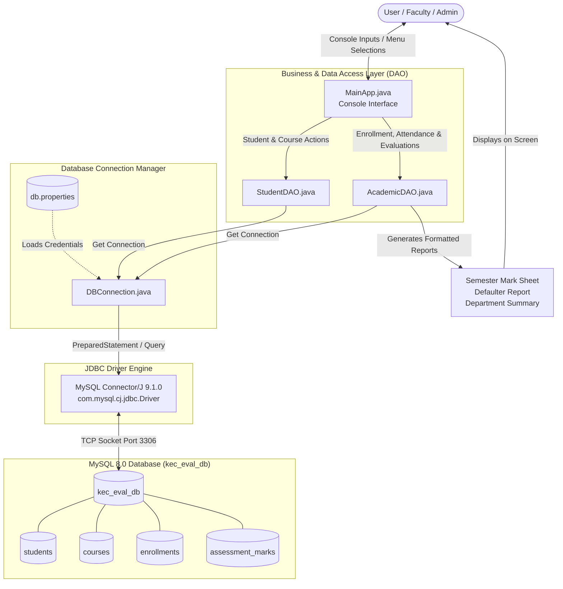
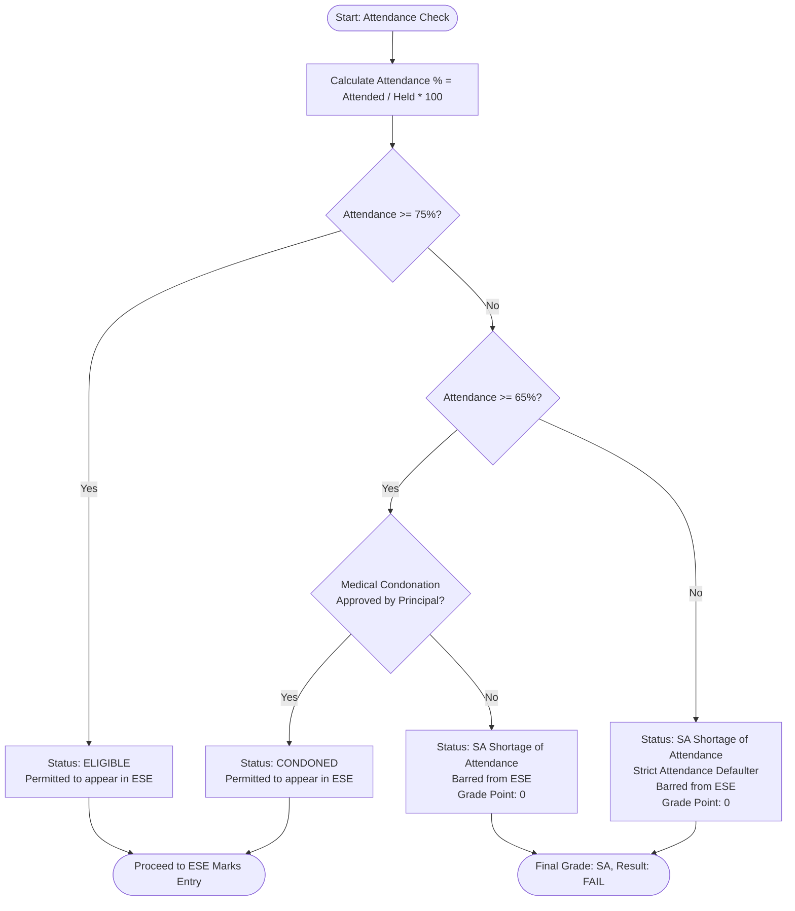
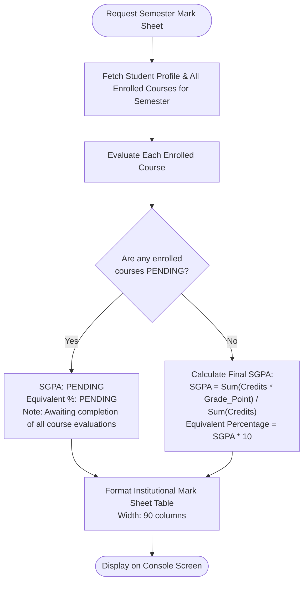
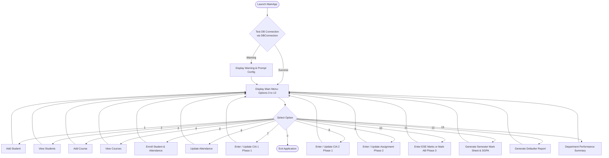

# Kongu Engineering College (Autonomous), Perundurai, Erode - 638 060
## Regulation 2024 (R2024) Student Academic & Continuous Evaluation System
### System Architecture & Workflow Flowcharts

---

## 1. Overall System Architecture & JDBC Flow



---

## 2. Attendance Gating & ESE Eligibility Flowchart



---

## 3. Continuous Assessment & Course Evaluation Flowchart (KEC R2024)

```mermaid
flowchart TD
    StartEval([Start Course Evaluation]) --> AttCheck{Is Student Eligible\nfor ESE?}

    AttCheck -- No --> AssignSA[Grade: SA\nGrade Point: 0\nResult: FAIL SA]
    
    AttCheck -- Yes --> CheckAbsent{Was Student Absent\nfor ESE?}
    CheckAbsent -- Yes --> AssignAB[Grade: AB\nGrade Point: 0\nResult: ABSENT]

    CheckAbsent -- No --> CheckMarks{Are CIA 1, CIA 2,\nAssignment and ESE\nentered?}
    CheckMarks -- Incomplete --> AssignPending[Status: PENDING\nGrade: --, GP: --\nResult: PENDING]

    CheckMarks -- Complete --> CalcInternal["Calculate 100-Scale Internal:\nCIA_100 = CIA1*0.40 + CIA2*0.40 + Assignment*0.20"]

    CalcInternal --> CheckType{Course Type?}

    CheckType -- THEORY --> ScaleTheory["CIA_W = CIA_100 * 0.40 (Max 40)\nESE_W = (ESE/100) * 60 (Max 60)\nMin ESE Required: 27 / 60"]
    CheckType -- PRACTICAL --> ScalePrac["CIA_W = CIA_100 * 0.60 (Max 60)\nESE_W = (ESE/100) * 40 (Max 40)\nMin ESE Required: 20 / 40"]
    CheckType -- EMBEDDED --> ScaleEmbed["CIA_W = CIA_100 * 0.50 (Max 50)\nESE_W = (ESE/100) * 50 (Max 50)\nMin ESE Required: 22.5 / 50"]

    ScaleTheory --> SumMarks[Total Marks = CIA_W + ESE_W]
    ScalePrac --> SumMarks
    ScaleEmbed --> SumMarks

    SumMarks --> CheckPass{ESE_W >= Min ESE\nAND\nTotal Marks >= 50?}

    CheckPass -- No --> GradeRA[Grade: RA\nGrade Point: 0\nResult: RE-APPEAR RA]
    
    CheckPass -- Yes --> GradeScale{Total Marks Range}
    GradeScale -- 91 to 100 --> GradeO[Grade: O | GP: 10]
    GradeScale -- 81 to 90 --> GradeA1[Grade: A+ | GP: 9]
    GradeScale -- 71 to 80 --> GradeA[Grade: A | GP: 8]
    GradeScale -- 61 to 70 --> GradeB1[Grade: B+ | GP: 7]
    GradeScale -- 50 to 60 --> GradeB[Grade: B | GP: 6]

    GradeO --> EndPass([Result: PASS])
    GradeA1 --> EndPass
    GradeA --> EndPass
    GradeB1 --> EndPass
    GradeB --> EndPass
    GradeRA --> EndFail([Result: FAIL])
    AssignSA --> EndFail
    AssignAB --> EndFail
    AssignPending --> EndPending([Result: PENDING])
```

---

## 4. Semester Mark Sheet & SGPA Calculation Flowchart



---

## 5. Main Application Menu Navigation Flowchart


