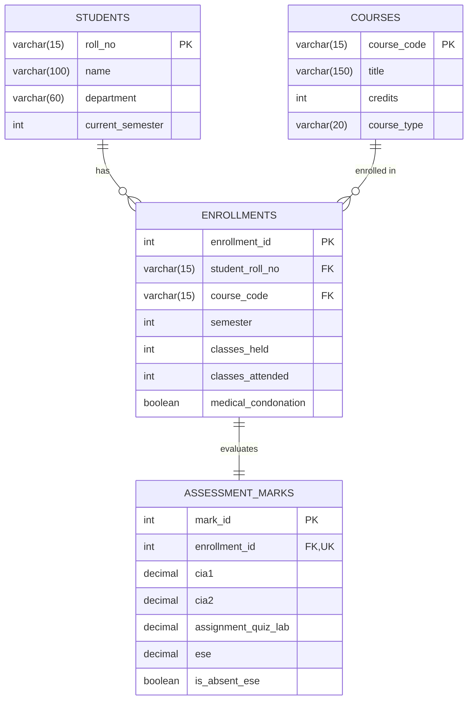

# Kongu Engineering College (Autonomous), Perundurai, Erode – 638 060
## Regulation 2024 (R2024) Student Academic & Continuous Evaluation System
### Developed using Java 21, MySQL 8.0 & JDBC (MySQL Connector/J)

---

## 1. Project Overview

The **KEC R2024 Student Academic & Continuous Evaluation System** is a robust, beginner-friendly, console-based Java JDBC application tailored for second-year **B.Tech Information Technology** students.

The application adheres to the **Kongu Engineering College (Autonomous) Regulation 2024 (R2024)** academic guidelines, offering:
1. **Curriculum & Demographic Management**: Full CRUD operations for Students and Courses (Theory, Practical, Embedded).
2. **Attendance Gating & Condonation Workflow**: Enforces the 75% attendance threshold, medical condonation approval for 65%–74.9%, and strict SA (Shortage of Attendance) barring for attendance below 65%.
3. **Phased Incremental Assessment Entry**:
   - **Phase 1**: Continuous Internal Assessment tests (CIA 1 and CIA 2).
   - **Phase 2**: Assignments, technical quizzes, and laboratory evaluations.
   - **Phase 3**: End Semester Examination (ESE) marks or Absent (AB) marking.
   - *Atomically preserves existing marks when updating any specific assessment component.*
4. **Weighted Course Evaluation Rules**:
   - **THEORY**: 40% CIA, 60% ESE (Minimum ESE Contribution: 27/60; Overall Pass: 50/100).
   - **PRACTICAL**: 60% CIA, 40% ESE (Minimum ESE Contribution: 20/40; Overall Pass: 50/100).
   - **EMBEDDED**: 50% CIA, 50% ESE (Minimum ESE Contribution: 22.5/50; Overall Pass: 50/100).
5. **Grading & Reporting**:
   - Letter grades (`O`, `A+`, `A`, `B+`, `B`, `RA`, `SA`, `AB`).
   - Grade points (10, 9, 8, 7, 6, 0).
   - Official institutional Semester Mark Sheet with SGPA and Equivalent Percentage ($SGPA \times 10$).
   - Defaulter reporting and departmental pass/fail summaries.
   - Transparent handling of `PENDING` results without score distortion.

---

## 📹 Project Demonstration & Explanation Video

Click below to download or stream the complete project demonstration video (**`video-project-1_compressed.mp4`**):

[-2ea44f?style=for-the-badge&logo=github)](video-project-1_compressed.mp4?raw=true)
[](video-project-1_compressed.mp4)

> [!TIP]
> - 📥 **Direct One-Click Download**: [**Download `video-project-1_compressed.mp4`**](video-project-1_compressed.mp4?raw=true) *(or [Mirror Raw Link](https://github.com/pavens25it/KEC-R2024-Student-Evaluation-System/raw/main/video-project-1_compressed.mp4))*
> - ▶️ **Watch Online on GitHub**: [**Open `video-project-1_compressed.mp4`**](video-project-1_compressed.mp4)

---

## 2. Directory Structure

```
d:\Anti_Stuff !\JavaProject\
├── video-project-1_compressed.mp4 # Demonstration & explanation video (direct download)
├── kec_schema.sql         # Complete MySQL DDL & DML seed script
├── DBConnection.java      # JDBC connection manager (loads db.properties)
├── StudentDAO.java        # Student & Course CRUD data access layer
├── AcademicDAO.java       # Enrollment, attendance, phased assessments & reports
├── MainApp.java           # Interactive 13-item console menu application
├── TestRunner.java        # Automated test suite verifying 39 KEC R2024 rules
├── db.properties          # Externalized database credentials (safe from Git)
├── .gitignore             # Safeguards passwords and build artifacts
├── compile.bat            # Windows 1-click compilation script
├── run.bat                # Windows 1-click execution script
├── FLOWCHARTS.md          # Architecture, attendance gating, evaluation & SGPA flowcharts
├── lib\
│   └── mysql-connector-j-9.1.0.jar  # Bundled official MySQL JDBC Driver
└── README.md              # Detailed documentation & Viva Voce guide
```

---

## 3. Database Schema (`kec_schema.sql`)

The database consists of **4 normalized tables** with primary keys, foreign keys with cascading updates/deletes, check constraints, and unique constraints:



### Table Details:
1. **`students`**:
   - `roll_no` (VARCHAR 15, PK): Unique roll number (e.g. `24ITR001`).
   - `name` (VARCHAR 100): Student's full name.
   - `department` (VARCHAR 60): Department name.
   - `current_semester` (INT, CHECK 1 to 8): Current academic semester.
2. **`courses`**:
   - `course_code` (VARCHAR 15, PK): Course catalog code (e.g. `24ITT31`).
   - `title` (VARCHAR 150): Course subject title.
   - `credits` (INT, CHECK 1 to 10): Credits assigned.
   - `course_type` (VARCHAR 20, CHECK IN `'THEORY'`, `'PRACTICAL'`, `'EMBEDDED'`).
3. **`enrollments`**:
   - `enrollment_id` (INT AUTO_INCREMENT, PK).
   - `student_roll_no` (FK -> `students.roll_no` ON DELETE CASCADE).
   - `course_code` (FK -> `courses.course_code` ON DELETE CASCADE).
   - `semester` (INT, CHECK 1 to 8).
   - `classes_held` (INT, CHECK >= 0), `classes_attended` (INT, CHECK >= 0).
   - `medical_condonation` (BOOLEAN): Approval flag for attendance between 65% and 74.9%.
   - Constraints: `classes_attended <= classes_held` and `UNIQUE(student_roll_no, course_code, semester)`.
4. **`assessment_marks`**:
   - `mark_id` (INT AUTO_INCREMENT, PK).
   - `enrollment_id` (INT, UNIQUE, FK -> `enrollments.enrollment_id` ON DELETE CASCADE).
   - `cia1`, `cia2`, `assignment_quiz_lab`, `ese` (DECIMAL(5,2), CHECK 0.00 to 100.00).
   - `is_absent_ese` (BOOLEAN): Flag for absent students (Result: `AB`, GP: `0`).

---

## 4. Evaluation Rules & Calculation Logic (KEC R2024)

### A. Internal Continuous Assessment (CIA) Calculation
Each assessment component is entered on a scale of **0 to 100**.
The system computes the 100-scale internal assessment using the **working assumption formula**:
$$\text{CIA}_{\text{100}} = (\text{CIA 1} \times 0.40) + (\text{CIA 2} \times 0.40) + (\text{Assignment/Lab} \times 0.20)$$

*(Note: The formula is modularly encapsulated in `AcademicDAO.java` and can be toggled via `AcademicDAO.setActiveFormula()` to support other variants like CIA Average 80% + Assignment 20% or Equal Weighting).*

### B. Course Type Weightage Breakdown
| Course Type | CIA Weight | ESE Weight | Min ESE Contribution Required | Overall Minimum Total |
| :--- | :---: | :---: | :---: | :---: |
| **THEORY** | 40% | 60% | **27.0 / 60** (45% in ESE) | **50.0 / 100** |
| **PRACTICAL** | 60% | 40% | **20.0 / 40** (50% in ESE) | **50.0 / 100** |
| **EMBEDDED** | 50% | 50% | **22.5 / 50** (45% in ESE) | **50.0 / 100** |

$$\text{Final Total} = \text{Weighted CIA} + \text{Weighted ESE}$$
> **Passing Condition**: A student must satisfy **BOTH** the applicable ESE minimum contribution **AND** attain an overall total $\ge 50.0$.

### C. Grade & Grade Point Mapping
| Total Marks Range | Letter Grade | Grade Point (GP) | Status / Result |
| :---: | :---: | :---: | :--- |
| **91 – 100** | **O** (Outstanding) | **10** | PASS |
| **81 – 90** | **A+** (Excellent) | **9** | PASS |
| **71 – 80** | **A** (Very Good) | **8** | PASS |
| **61 – 70** | **B+** (Good) | **7** | PASS |
| **50 – 60** | **B** (Above Average) | **6** | PASS |
| **< 50** or Failed ESE Min | **RA** (Re-Appear / Fail) | **0** | RE-APPEAR (RA) |
| Ineligible Attendance | **SA** (Shortage of Attendance) | **0** | BARRED FROM ESE (SA) |
| Absent in ESE | **AB** (Absent) | **0** | ABSENT (AB) |
| Missing Assessment | **PENDING** | **null** | PENDING EVALUATION |

### D. Attendance Gating Rules
- **$\ge 75\%$**: Eligible to sit for End Semester Examination.
- **$65\% \le \text{Attendance} < 75\%$**: Conditionally eligible. Must receive formal approval for **Medical Condonation** from the Principal/Dean. If not approved $\rightarrow$ **SA** (Grade Point 0, Barred).
- **$< 65\%$**: Strict Attendance Shortage $\rightarrow$ **SA** (Grade Point 0, Barred from ESE).

### E. SGPA & Percentage Formula
$$\text{SGPA} = \frac{\sum (\text{Course Credits} \times \text{Grade Point})}{\sum \text{Registered Course Credits}}$$
$$\text{Equivalent Percentage} = \text{SGPA} \times 10$$

> **Consistent Pending Handling**: If any enrolled course has incomplete CIA or missing ESE marks, the course is marked as `PENDING`, and SGPA is reported as `PENDING` rather than falsely deflating the student's cumulative score.

---

## 5. Step-by-Step Setup & Execution Instructions

### Prerequisites
- **Java JDK 17 or Java 21** installed (`javac -version` and `java -version`).
- **MySQL 8.0 Server** or **XAMPP MySQL** running on port `3306`.

---

### Step 1: Database Initialization
Open Command Prompt or PowerShell and execute `kec_schema.sql` into your MySQL server:

#### If using Oracle MySQL 8.0:
```cmd
"C:\Program Files\MySQL\MySQL Server 8.0\bin\mysql.exe" -u root -p < "d:\Anti_Stuff !\JavaProject\kec_schema.sql"
```
*(Enter your MySQL root password when prompted).*

#### If using XAMPP MySQL (default root with blank password):
```cmd
"C:\xampp\mysql\bin\mysql.exe" -u root < "d:\Anti_Stuff !\JavaProject\kec_schema.sql"
```

This creates the database `kec_eval_db`, creates all 4 tables, and pre-populates sample students, courses, enrollments, and phased marks.

---

### Step 2: Configure Credentials in `db.properties`
Open `db.properties` in your project folder:
```properties
# ============================================================================
# Database Configuration for KEC R2024 Academic Evaluation System
# ============================================================================
db.url=jdbc:mysql://localhost:3306/kec_eval_db?useSSL=false&allowPublicKeyRetrieval=true&serverTimezone=UTC&createDatabaseIfNotExist=true
db.user=root
db.password=YOUR_MYSQL_PASSWORD_HERE
```
*(Replace `YOUR_MYSQL_PASSWORD_HERE` with your actual MySQL password. If using default XAMPP, leave it blank).*

---

### Step 3: Compile the Project
You can either double-click **`compile.bat`** or run from terminal:
```cmd
javac -cp ".;lib\mysql_classes;lib\mysql-connector-j-9.1.0.jar" *.java
```
All `.class` files will be generated without errors or warnings.

---

### Step 4: Run the Automated Verification Suite
Run **`test.bat`** or run:
```cmd
java -cp ".;lib\mysql_classes;lib\mysql-connector-j-9.1.0.jar" TestRunner
```
**Expected Output**:
```
============================================================================
 KONGU ENGINEERING COLLEGE (R2024) - AUTOMATED VERIFICATION TEST SUITE
============================================================================
  [PASS] Theory Case A: Grade => O
  [PASS] Theory Case A: GP => 10
  [PASS] Theory Case B (ESE Min Fail): Grade => RA
  [PASS] Practical (85 marks): Grade => A+
  [PASS] Embedded: Grade => B+
  [PASS] Attendance >= 75%: Eligible => true
  [PASS] Attendance 70% without Condonation: Grade => SA
  [PASS] Attendance < 65%: Grade => SA
  [PASS] Absent in ESE: Grade => AB
  [PASS] Missing ESE: Grade => PENDING
  [PASS] SGPA Verification => 9.11
  [PASS] Equivalent % Verification => 91.10
============================================================================
 TEST SUMMARY: Total Run: 39 | Passed: 39 | Failed: 0
============================================================================
>>> ALL EVALUATION RULES VERIFIED SUCCESSFULLY UNDER KEC R2024! <<<
```

---

### Step 5: Launch the Interactive Menu Application
Double-click **`run.bat`** or execute:
```cmd
java -cp ".;lib\mysql_classes;lib\mysql-connector-j-9.1.0.jar" MainApp
```

---

## 6. Menu Walkthrough & Demonstration Scenarios

### Main Menu Options:
```
----------------------------------------------------------------------------
                             MAIN MENU SELECTIONS                           
----------------------------------------------------------------------------
 [1]  Add student
 [2]  View students
 [3]  Add course
 [4]  View courses
 [5]  Enroll student and record attendance
 [6]  Update attendance
 [7]  Enter / update CIA 1 (Phase 1)
 [8]  Enter / update CIA 2 (Phase 1)
 [9]  Enter / update Assignment / Quiz / Lab marks (Phase 2)
 [10] Enter ESE marks or mark Absent (AB) (Phase 3)
 [11] Generate semester mark sheet (SGPA & Equivalent %)
 [12] Attendance defaulter report (< 65% or unapproved condonation)
 [13] Department performance summary
 [0]  Exit application
----------------------------------------------------------------------------
```

### Demonstration Workflow (For Lab Practical Viva & Screenshots):

#### Demo 1: Add a New Student & Course
1. Choose **`[1]`**: Enter Roll Number `24ITR099`, Name `Kavya S`, Department `Information Technology`, Current Semester `3`.
2. Choose **`[2]`**: Verify student `24ITR099` appears in the registered student list.
3. Choose **`[3]`**: Add Course `24ITT35`, Title `Computer Networks`, Credits `3`, Type `THEORY` (`1`).
4. Choose **`[4]`**: Verify course `24ITT35` is cataloged with `CIA 40% | ESE 60% (>=27)`.

#### Demo 2: Enroll Student & Test Attendance Gating
1. Choose **`[5]`**: Enroll `24ITR099` in `24ITT35`, Semester `3`.
   - Classes Held: `50`, Classes Attended: `35` (70.0% attendance).
   - System prompts: Attendance is 70% $\rightarrow$ requires medical condonation.
   - Enter `Y` (Approved).

#### Demo 3: Phased Incremental Assessment Updates
1. Choose **`[7]`** (Phase 1): Enter CIA 1 = `85.0`.
2. Choose **`[8]`** (Phase 1): Enter CIA 2 = `88.0`. Existing CIA 1 mark is preserved!
3. Choose **`[9]`** (Phase 2): Enter Assignment = `90.0`. CIA 1 & 2 are preserved!
4. Choose **`[11]`**: View mark sheet for `24ITR099` (Semester 3). Notice status is cleanly displayed as `PENDING` because ESE has not been conducted yet. SGPA remains pending without false zero values!
5. Choose **`[10]`** (Phase 3): Enter ESE Mark = `82.0`.
6. Choose **`[11]`**: View finalized mark sheet $\rightarrow$ Total: `85.80`, Grade: `A+`, GP: `9`, Result: `PASS`, SGPA: `9.00 / 10.00`.

#### Demo 4: Attendance Defaulter Report
1. Choose **`[12]`**: Observe student `24ITR088` (56% attendance $\rightarrow$ Below 65% Barred SA) and `24ITR045` (68% without condonation $\rightarrow$ Barred SA).

#### Demo 5: Department Performance Summary
1. Choose **`[13]`**: View departmental metrics breakdown (Passed, Failed RA, Defaulter SA, Absent AB, Pending, and Class Average SGPA).

---

## 7. Sample Generated Semester Mark Sheet Output

```
==========================================================================================
                 KONGU ENGINEERING COLLEGE (AUTONOMOUS) - ERODE - 638 060                 
                      AFFILIATED TO ANNA UNIVERSITY | REGULATION 2024                     
                            GRADE SHEET - SEMESTER EVALUATION                             
==========================================================================================
 Roll Number : 24ITR001                  Department : Information Technology
 Student Name: Aarav Kumar S             Semester   : 3
------------------------------------------------------------------------------------------
| CODE    | COURSE TITLE       | TYPE | CR | ATT%  | CIA  | ESE  | TOT  | GR | GP | RESULT  |
------------------------------------------------------------------------------------------
| 24ITC31 | Object Oriented... | EMBD |  4 | 90.0% | 47.4 | 46.0 | 93.4 | O  | 10 | PASS    |
| 24ITP31 | Data Structures... | PRAC |  2 | 93.3% | 52.3 | 34.0 | 86.3 | A+ |  9 | PASS    |
| 24ITT31 | Data Structures... | THRY |  3 | 92.0% | 36.7 | 52.8 | 89.5 | A+ |  9 | PASS    |
------------------------------------------------------------------------------------------
 Registered Credits : 9    Earned Credits : 9    Passed: 3   Failed: 0   Pending: 0 
 Semester GPA (SGPA): 9.44 / 10.00
 Equivalent Mark %  : 94.40%
==========================================================================================
 Grading: O (91-100, GP 10) | A+ (81-90, GP 9) | A (71-80, GP 8) | B+ (61-70, GP 7) | B (50-60, GP 6)
 Arrears: RA (Re-Appear, GP 0) | SA (Shortage of Attendance, GP 0) | AB (Absent, GP 0)
 Passing: Total >= 50 AND ESE Min met (Theory: 27/60, Practical: 20/40, Embedded: 22.5/50)
==========================================================================================
```

---

## 8. Viva Voce & Practical Exam Preparation Guide (For 2nd Year B.Tech IT)

Here are the key questions external examiners frequently ask during Java JDBC practical reviews:

### Q1: What is JDBC and what are its four core architectural components?
**Answer**: Java Database Connectivity (JDBC) is a Java API that enables Java programs to interact with relational databases. The four core components are:
1. **`DriverManager`**: Loads and manages database drivers.
2. **`Driver`** (`com.mysql.cj.jdbc.Driver`): Translates Java JDBC calls into MySQL network protocol packets.
3. **`Connection`**: Establishes the communication socket session between Java and the database.
4. **`Statement` / `PreparedStatement`**: Executes SQL queries and updates.
5. **`ResultSet`**: Encapsulates cursor-based tabular results returned by `SELECT` queries.

### Q2: Why did you use `PreparedStatement` instead of `Statement`?
**Answer**:
1. **Security**: `PreparedStatement` uses parameter placeholders (`?`), completely preventing **SQL Injection Attacks**.
2. **Pre-compilation & Performance**: The database parses, compiles, and optimizes the SQL template once. Repeated executions with varying parameters run faster.
3. **Data Type Safety**: Handles complex types, escaping, and `NULL` conversions safely (e.g. `pstmt.setNull(1, Types.DECIMAL)`).

### Q3: Why is try-with-resources used for database operations?
**Answer**: In JDBC, open `Connection`, `PreparedStatement`, and `ResultSet` objects consume valuable system sockets and database cursors. Java 7+ **try-with-resources** implements the `AutoCloseable` interface, guaranteeing that every database resource is reliably closed even if a runtime `SQLException` occurs, preventing database connection leaks.

### Q4: Why are database credentials stored in `db.properties` instead of being hardcoded?
**Answer**: Hardcoding passwords in Java source files violates cybersecurity best practices and risks exposing credentials if pushed to version control systems like Git. By reading from `db.properties` or environment variables, credentials can be modified per deployment environment without recompiling the Java code.

### Q5: How does the application handle incremental mark updates without overwriting previous marks?
**Answer**: In `AcademicDAO.java`, each assessment phase executes an atomic SQL `UPDATE` statement targeting only the specific column (e.g., `UPDATE assessment_marks SET cia1 = ? WHERE enrollment_id = ?`). The existing values of `cia2`, `assignment_quiz_lab`, and `ese` remain unchanged.

### Q6: How are pending marks handled in SGPA calculation?
**Answer**: If a student is awaiting ESE or CIA marks, the course result is marked as `PENDING`. The system deliberately **does not** compute an incomplete SGPA by treating missing values as 0, as doing so would falsely report an inflated failure rate or misrepresent student merit.
